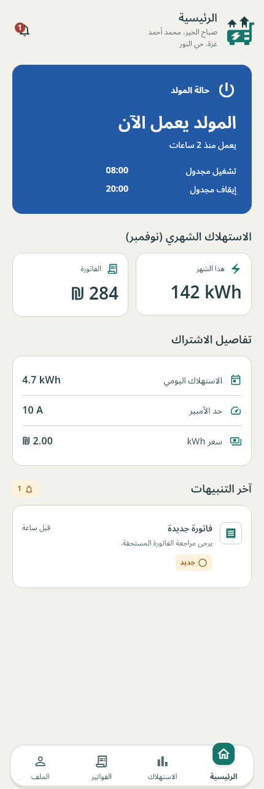
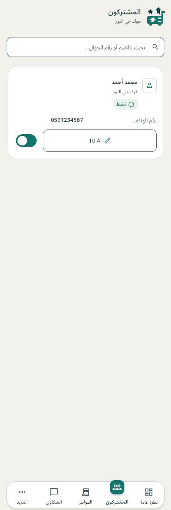
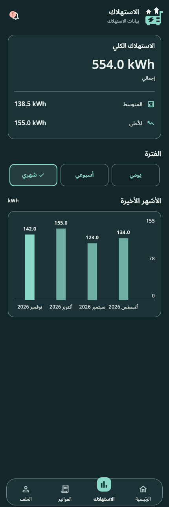
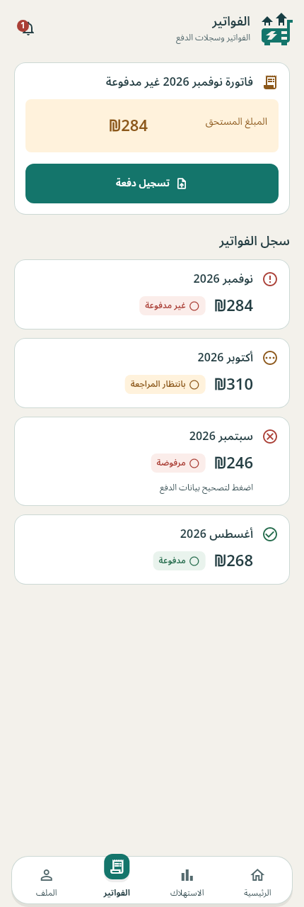
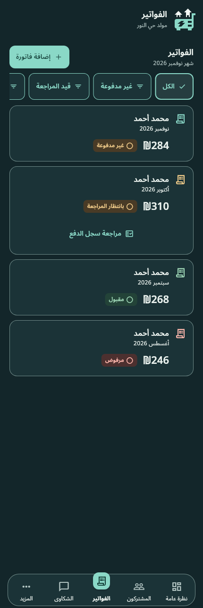
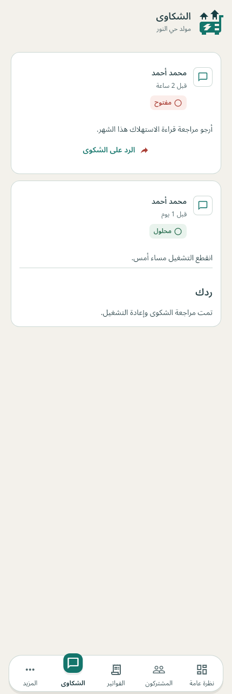

<p align="center">
  <picture>
    <source media="(prefers-color-scheme: dark)" srcset="assets/brand/lockup-reversed.svg">
    
  </picture>
</p>

<h1 align="center">طاقة الحي، في مكان واحد</h1>

<p align="center">
  تطبيق عربي يربط أصحاب المولدات بالمشتركين، لتنظيم التشغيل والفواتير والإيصالات والاستهلاك وطلبات الدعم.
</p>

<p align="center">
  <a href="#صور-من-التطبيق">صور التطبيق</a> ·
  <a href="#المميزات">المميزات</a> ·
  <a href="#التشغيل-محلياً">التشغيل</a> ·
  <a href="#الوثائق">الوثائق</a>
</p>

<p align="center">
  
  
  
  
</p>

## عن التطبيق

**بوابة المولدات** خدمة لتنظيم العلاقة بين مولد الحي والأسر المشتركة فيه، انطلاقاً من واقع انقطاع كهرباء الشبكة في غزة. يستطيع كل صاحب مولد إدارة مشتركيه وبيانات مولده ضمن حساب مستقل، بينما يجد المشترك معلومات اشتراكه وفواتيره وتنبيهاته في واجهة عربية واحدة.

يدعم المشروع **عدة مولدات**، مع فصل بياناتها باستخدام `generatorId`، وثلاثة أدوار: **المشترك، صاحب المولد، والمشرف العام**. الهوية البصرية موحّدة، مع خط عربي مضمّن، واتجاه RTL، ووضعين فاتح وداكن.

## صور من التطبيق

لقطات فعلية من واجهات Flutter، مأخوذة من اختبارات العرض ببيانات تجريبية. يمكن الضغط على أي صورة لعرضها بالحجم الكامل؛ هذه ليست بيانات مستخدمين حقيقيين أو صوراً ملتقطة من هاتف.

<table dir="rtl">
  <tr>
    <th align="center">رئيسية المشترك</th>
    <th align="center">إدارة المشتركين</th>
    <th align="center">الاستهلاك — الوضع الداكن</th>
  </tr>
  <tr>
    <td align="center"><a href="screenshots/redesign/consumer_light.png"></a></td>
    <td align="center"><a href="screenshots/redesign/admin/subscribers_light.png"></a></td>
    <td align="center"><a href="screenshots/redesign/consumer/usage_dark.png"></a></td>
  </tr>
  <tr>
    <th align="center">فواتير المشترك</th>
    <th align="center">إدارة الفواتير — الوضع الداكن</th>
    <th align="center">الشكاوى والمتابعة</th>
  </tr>
  <tr>
    <td align="center"><a href="screenshots/redesign/consumer/bills_light.png"></a></td>
    <td align="center"><a href="screenshots/redesign/admin/bills_dark.png"></a></td>
    <td align="center"><a href="screenshots/redesign/admin/complaints_light.png"></a></td>
  </tr>
</table>

[استعراض بقية الشاشات والحوارات](screenshots/redesign/) · [الشعار والهوية البصرية](docs/brand.md)

## المميزات

| المشترك | صاحب المولد | المشرف العام |
| --- | --- | --- |
| اختيار مولد مقبول من إدارة التطبيق ونشط، والانتظار حتى قبول طلب الاشتراك | تقديم طلب تسجيل المولد ومتابعة حالته | مراجعة طلبات أصحاب المولدات وقبولها أو رفضها مع السبب |
| متابعة حالة تشغيل المولد ومواعيده | إدارة حالة التشغيل والجدولة وسعر الكهرباء | عرض أصحاب المولدات بجميع حالاتهم والبحث والتصفية |
| عرض الفواتير وتسجيل بيانات الدفع | إصدار الفواتير ومراجعة سجلات الدفع | تعليق المولدات وإعادة تفعيلها |
| متابعة الاستهلاك والرسوم البيانية | إدارة المشتركين وطلبات الانضمام | تفعيل اشتراك المولد أو إيقافه مع تأكيد التغيير |
| إرسال الشكاوى ومتابعة الردود | الرد على الشكاوى وتحديث حالاتها | التحكم في أهلية ظهور المولد في قائمة الاختيار |

**الدخول والحساب:** بريد إلكتروني حقيقي وكلمة مرور، مع التحقق بالبريد واستعادة كلمة المرور برسالة بريد. الهاتف والهوية بيانات خاصة بالحساب فقط. لا توجد طرق دخول بالهوية أو SMS أو وضع دخول تجريبي.

**التنبيهات:** سجل داخل التطبيق وإشعارات محلية؛ لا يعتمد المشروع على Firebase Cloud Messaging لإشعارات دفع من خادم.

## التقنيات

- **Flutter وDart** لبناء الواجهات، مع **Riverpod** للحالة و**go_router** للتنقل.
- **Firebase Authentication** للبريد وكلمة المرور، و**Cloud Firestore** للبيانات وقواعد الصلاحيات.
- نظام تصميم مشترك وخط **Noto Sans Arabic** مضمّن داخل الأصول دون تحميل خط وقت التشغيل.
- حفظ تفضيل الثيم محلياً باستخدام **SharedPreferences**.
- تُحفظ إفادة الدفع كمبلغ وتاريخ ورقم مرجعي وطريقة دفع داخل الفاتورة. لا توجد صور إيصالات جديدة أو Firebase Storage أو Cloud Functions في هذه المرحلة.

## التشغيل محلياً

### 1. المتطلبات وتنزيل المشروع

ثبّت Flutter stable متوافقاً مع `pubspec.yaml` وAndroid SDK، ثم تأكد من جاهزية بيئتك عبر `flutter doctor`. آخر بيئة تحقق استخدمت Flutter **3.41.9** وDart **3.11.5**.

```bash
git clone https://github.com/Mohmmed-AlShweikh/Power-House.git
cd Power-House
flutter pub get
```

### 2. إعداد Firebase

استخدم مشروع Firebase مخصصاً للتطوير، وأضف تطبيق Android المطابق لإعدادات المشروع:

1. فعّل **Email/Password** فقط وعطّل **Phone** من Authentication → Sign-in method، وأبقِ المشروع على Spark دون تفعيل الفوترة.
2. جهّز ملف إعداد Android الخاص بمشروعك `android/app/google-services.json`، مع التأكد من تطابق المعرّف `com.example.power_share` ومشروع الاختبار.
3. اتبع [خطوات المرحلة الأولى ومهام Firebase اليدوية](docs/spark-phase1.md). هذه المرحلة تفترض مشروعاً نظيفاً وحسابات اختبار؛ لا تتضمن ترحيلاً لحسابات قديمة.
4. جهّز حساب المشرف العام بطريقة موثوقة عبر Firebase Console أو Admin SDK؛ تسجيل المولد من التطبيق لا يمنحه صلاحية المشرف العام.

استخدم بريداً حقيقياً يمكنك فتح رسائل التحقق والاستعادة فيه. لا تضف كلمات مرور أو مفاتيح حسابات الخدمة أو ملفات إعدادك المحلية إلى commits.

### 3. تشغيل Android وبناء APK

```bash
flutter devices
flutter run -d <android-device-id>

# APK للتجربة
flutter build apk --debug

# APK إصدار؛ جهّز توقيع الإصدار وإعدادات Firebase أولاً
flutter build apk --release
```

توجد الملفات الناتجة داخل `build/app/outputs/flutter-apk/`. بناء APK لا ينشر التطبيق على المتجر ولا ينشر قواعد Firebase تلقائياً.

## الاختبارات والتحقق

```bash
flutter analyze
flutter test
```

تتضمن المجموعة اختبارات golden تعتمد تاريخاً ثابتاً. لتشغيل المجموعة كاملة داخل بيئة Linux السحابية المهيأة للمشروع:

```bash
PORTAL_TEST_TARGET=test ./tool/test_visual.sh
```

السكريبت يستخدم مسارات بيئة التطوير؛ عند نقله إلى جهاز آخر راجع إعدادات Flutter والكاش فيه. لتشغيل اختبارات Firebase على **المحاكيات المحلية فقط**، يلزم Node.js وJava متوافقان مع أدوات Firebase:

```bash
npm ci --prefix tools/rules-tests
npx --prefix tools/rules-tests firebase emulators:exec --project demo-generator-portal --config firebase.auth-test.json --only auth,firestore "node --test tools/rules-tests/rules.test.mjs tools/rules-tests/auth.test.mjs"
```

داخل البيئة السحابية، يوفر `python tool/run_spark_emulators.py` الإعدادات نفسها ويخفي طباعة رموز SMS التجريبية من أدوات المحاكي.

نتائج اختبارات Flutter والمحاكيات وبناء أندرويد موثقة في [نتائج المرحلة الأولى](docs/validation/spark-phase1-validation.json). التحقق على هاتف Android فعلي يبقى خطوة مستقلة.

## بنية المشروع

```text
lib/
├── config/       # توجيه المستخدم وحراس الدخول وإعدادات التطبيق
├── models/       # نماذج المستخدمين والمولدات والفواتير وغيرها
├── providers/    # الحالة ومصادر البيانات التفاعلية
├── services/     # المصادقة والربط وعمليات Firestore والإشعارات
├── theme/        # ألوان الهوية والخطوط والثيم والتوكنات
└── views/
    ├── screens/  # شاشات المشترك وصاحب المولد والمشرف العام
    └── widgets/  # مكونات الواجهة المشتركة
```

مجموعات Firestore الأساسية: `users`، `generators`، `generatorDirectory`، `bills`، `alerts`، `complaints`، `consumption`.

## الوثائق

| الموضوع | المرجع |
| --- | --- |
| الهوية والشعار والألوان والخط | [دليل الهوية](docs/brand.md) |
| عزل بيانات المولدات والصلاحيات | [تصميم تعدد المولدات](docs/multi-generator-design.md) |
| إعداد البريد والدفع والموافقات والمهام اليدوية | [المرحلة الأولى المجانية](docs/spark-phase1.md) |
| أسباب أخطاء التحميل والمعالجة المركزية | [التحميل التلقائي](docs/auto-load.md) |
| شاشة البداية وإدارة اشتراكات أصحاب المولدات | [تقرير التعديلات](docs/splash-and-owner-switch.md) |
| صور الواجهات | [معرض اللقطات](screenshots/redesign/) |

المرحلة الثانية لم تبدأ: التقارير والتصدير وسجل التدقيق والنسخ الاحتياطي ومؤشرات المزامنة ومواعيد الاشتراكات وتطوير الإشعارات ومراجعة الواجهات العامة مؤجلة. حصص Spark والبريد المجانية محدودة؛ تجاوزها قد يوقف الخدمة، ولا يضمن المشروع تشغيلًا مجانياً غير محدود.
