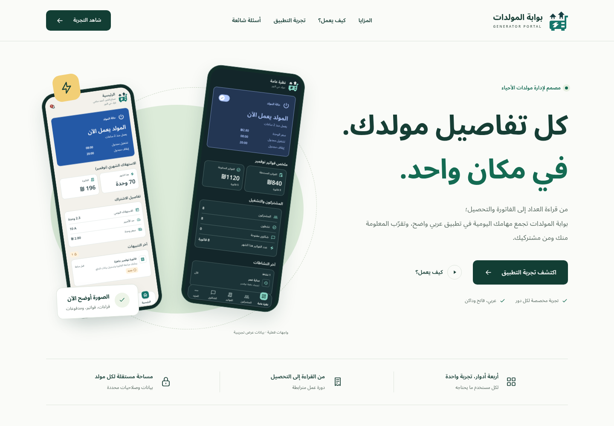

# صفحة هبوط بوابة المولدات



صفحة منتج عربية RTL لأصحاب مولدات الأحياء، مبنية على فكرة المشروع الحالية. لا تغيّر كود Flutter أو المصادقة أو البيانات أو قواعد Firebase. لا تضيف اعتماداً أو خدمة مدفوعة.

## محتويات الصفحة

- عنوان يوضح قيمة المنتج، وواجهتان فعليتان من التطبيق.
- مزايا القراءة والفوترة والتحصيل والمشتركين.
- عرض تفاعلي للأدوار الأربعة، مع الفاتح/الداكن وتكبير اللقطات.
- خطوات الانضمام والقراءة وإصدار الفاتورة ومراجعة الدفع.
- توضيح الأدوار وفصل بيانات المولدات، وأسئلة شائعة.
- تنزيل عرض PDF موجود في المشروع، وأزرار تواصل اختيارية.
- قائمة هاتف، تنقل بلوحة المفاتيح، ودعم تقليل الحركة. الصور والبيانات توضيحية، ولا توجد شهادات عملاء أو أرقام استخدام مخترعة.

## التشغيل

من جذر المستودع:

```bash
node server.js --landing
```

افتح `http://localhost:5000/`. لتغيير المنفذ: `PORT=8080 node server.js --landing`.

بدون `--landing` يبقى سلوك Flutter web الحالي، وتتوفر الصفحة الجديدة على `/landing/`. مسار `/portfolio` ومعرضه يظلان متاحين. يمكن نشر مجلد `web/landing` كصفحة ثابتة مستقلة؛ لم ننشر استضافة أو نفعّل فوترة.

## التواصل

لم يُقدَّم رقم أو بريد عمل للنشر، لذا لا توجد بيانات اتصال مفترضة ولا نموذج يوهم بإرسال الطلب. أزرار المعاينة وPDF تعمل فعلياً.

لإظهار زر التواصل، ضع رقم واتساب دولياً من أرقام فقط أو بريداً عاماً في `web/landing/config.js`، ثم أعد التحميل. الرقم والبريد يصبحان علنيين؛ لا تضع أسراراً في هذا الملف. لا يحتاج ذلك Firebase أو خدمة نماذج، ولا تحفظ الصفحة بيانات زوار أو طلبات.

## نسخة تفتح مباشرة وحزمة المصدر

```bash
python tool/package_landing.py
```

ينشئ داخل `/workspace/artifacts/` ملف `Generator-Portal-Landing.html` مستقلاً بخطوط وصور وJavaScript مضمّنة، وحزمة `Generator-Portal-Landing.zip` تتضمن النسخة المستقلة ومجلد المصدر. الملف المستقل للعرض بالمتصفح دون خادم أو اتصال.

## التحقق

مع تشغيل الصفحة على المنفذ 5000:

```bash
python tool/landing_check.py
```

اختبارات Chromium المتأثرة فقط: 320/390/768/1024/1440px، الأدوار الأربعة × الوضعين، RTL بلوحة المفاتيح، القائمة، الحوار وEscape، الأسئلة الشائعة، إعدادات تواصل صحيحة/خاطئة، تنزيل PDF، ومنع اجتياز المسارات في تقديم ملفات الصفحة. لا توجد طلبات شبكة خارجية عند تحميل الصفحة أو أخطاء JavaScript أو ملفات مفقودة. النتائج في [validation.json](validation.json)، مع [لقطة سطح المكتب](desktop.png) و[لقطة الهاتف](mobile.png).

لا تشغيل لاختبارات Flutter الكاملة لأن التغيير يخص الصفحة الثابتة فقط. لا عمليات على Firebase الإنتاج، ولا تعديل main أو دمج هذه الصفحة فيه؛ العمل معزول على `feature/generator-landing`.
