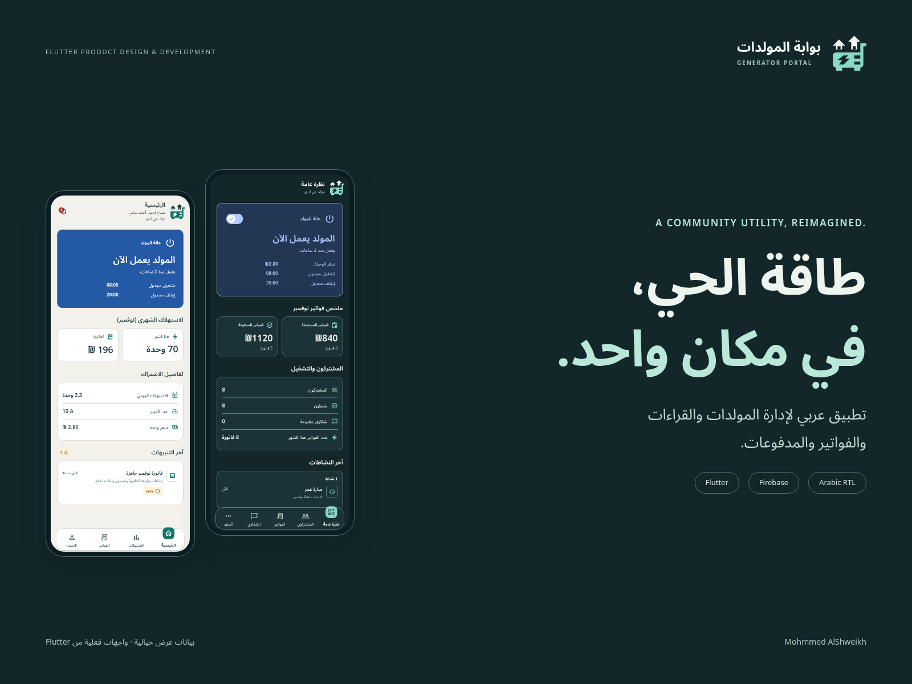

# بوابة المولدات — حزمة معرض الأعمال



**Mohmmed AlShweikh · Flutter Developer**

دراسة حالة تعرض الواجهات الحالية ومهارات Flutter وDart وRiverpod وFirebase. جميع الأسماء والبيانات خيالية؛ المظهر المهني لا يعني اعتماداً رسمياً أو مستخدمين تجاريين فعليين.

## الملفات الجاهزة

| الملف | الاستخدام |
| --- | --- |
| [الحزمة الكاملة ZIP](exports/Generator-Portal-Portfolio.zip) | تنزيل صفحة المعرض وملفات العرض معاً |
| [PDF — ست شرائح](exports/Generator-Portal-Case-Study.pdf) | لينكدإن: إنشاء منشور ← إضافة مستند |
| [الغلاف العربي 1600×1200](exports/portfolio-cover.png) | غلاف مشروع في مستقل أو صورة مصغرة |
| [الغلاف الإنجليزي 1600×1200](exports/portfolio-cover-en.png) | صورة غلاف لمشروع Upwork |
| [الشرائح PNG](exports/) | صور 1200×1500 للنشر الفردي أو المتسلسل |
| [نصوص النشر العربية والإنجليزية](publication-copy.md) | مستقل وUpwork ولينكدإن |
| [صفحة HTML التفاعلية](index.html) | دراسة حالة متجاوبة ومعرض فاتح/داكن وتكبير اللقطات |
| [معاينة الصفحة الطويلة](exports/website-preview.png) | عرض التصميم دون تشغيل HTML |
| [لقطات Flutter الأصلية](media/) | 14 لقطة عالية الدقة، فاتح وداكن |

## اختيار الصور للمنصات

- **مستقل:** الغلاف العربي، ثم الشرائح 02 و03 و04 و05، مع الوصف العربي في ملف النصوص.
- **Upwork:** الغلاف الإنجليزي، ثم الشرائح التي تظهر القراءات والمالية والثيمات؛ استخدم العنوان والوصف الإنجليزي، وعدّل دورك ليطابق مساهمتك الفعلية.
- **LinkedIn:** أضف PDF كمستند لعرض الشرائح، ثم انسخ أحد المنشورين. لا ننشر بالنيابة عنك، ولا نضيف أرقام عملاء أو نتائج تجارية غير مثبتة.
- يمكن نشر PNGs كصور بدلاً من PDF. راجع اقتصاص الغلاف داخل كل منصة قبل الحفظ.

## فتح الصفحة دون استضافة

بعد فك ZIP، افتح موجه الأوامر داخل المجلد وشغّل:

```bash
python -m http.server 8000
```

ثم افتح `http://localhost:8000/index.html`. الخطوط والصور محلية ولا تعتمد على CDN أو خدمة مدفوعة. GitHub يعرض ملفات الكود؛ لن ينشر HTML كموقع تلقائياً. لا تتضمن هذه المهمة تفعيل استضافة أو Firebase Hosting.

يمكن كذلك تشغيل `node server.js` من جذر المستودع ثم فتح `http://localhost:5000/portfolio`. صفحة المعرض القديمة أصبحت تعرض الهوية الحالية؛ ملفاتها العامة تُخدم من مسار `/portfolio-assets/` فقط.

## إعادة توليد المواد من المستودع

من جذر المشروع، في بيئة Flutter المهيأة:

```bash
PORTAL_TEST_TARGET=tool/portfolio/capture_test.dart tool/test_visual.sh
python tool/portfolio/export.py
```

أداة التصدير تحتاج Playwright وChromium محليين كأدوات عرض فقط؛ لا توجد اعتمادات تطبيق جديدة. ملف `capture_test.dart` يستخدم Fake Firestore وprovider overrides، ويحسب أمثلة الفوترة عبر المستودعات الحالية. لا يهيّئ Firebase الحقيقي أو يقرأ/يكتب أي بيانات إنتاج. لا يغيّر الاختبارات أو اللقطات المرجعية الأصلية.

اللقطات مولّدة من Widgets فعلية وليست صور جهاز. بيانات شاشة الرئيسية مستقلة عن دفتر الجولات الدوري، وتوضح المسارين الموجودين فعلياً. لم نغير منطق التطبيق أو نركّب نصوصاً مزيفة فوق الواجهات.

## التحقق والحدود

- نجاح التقاط الواجهات الأربع عشرة دون أخطاء عرض، وفحص الصفحة عند 320/390/768/1440px دون تمرير أفقي.
- عمل زر الفاتح/الداكن وتكبير الصور، وعدم وجود ملفات مفقودة أو طلبات شبكة خارجية عند التصدير.
- PDF من 6 صفحات، وصور PNG بالأحجام المذكورة. نتائج الفحص: [validation.json](validation.json).
- لا توجد ادعاءات بنشر المتجر أو اعتماد رسمي أو نتائج تجارية. لا تُنشر بيانات شخصية أو APK debug ضمن الحزمة.
- إعدادات Spark لها حصص؛ التطبيق لا يشغّل المولد مادياً. التنبيهات داخلية ومحلية، والمشاركة يدوية عبر Android.
